# Just Stealth It smart contracts

The EVM contracts behind Just Stealth It, and the Solana configs its launches use.

**Live on eight chains. Not audited.** The source here matches the deployed code byte for byte, and [you can check that yourself](#check-it-yourself).

| | |
| --- | --- |
| [`evm/`](evm) | Solidity source, two DEX builds, tests, deploy script, deployment records |
| [`solana/`](solana) | Raydium platforms, Meteora configs, lookup table. No custom program |
| [`docs/chains.md`](docs/chains.md) | Every contract on every chain, with explorer links |
| [`docs/contracts.md`](docs/contracts.md) | What each contract does, its functions and events |
| [`evm/docs/SPEC.md`](evm/docs/SPEC.md) | The full specification, including open risks |

## What's deployed

Seven contracts on each chain, from one source tree.



| Chain | Id | Gas | DEX | Build |
| --- | --- | --- | --- | --- |
| Robinhood Chain | 4663 | ETH | Uniswap v4 | default |
| BNB Chain | 56 | BNB | PancakeSwap Infinity CL | `infinity` |
| HyperEVM | 999 | HYPE | Uniswap v4 | default |
| Base | 8453 | ETH | Uniswap v4 | default |
| Arc | 5042 | USDC | Uniswap v4 | default |
| Ethereum | 1 | ETH | Uniswap v4 | default |
| Arbitrum One | 42161 | ETH | Uniswap v4 | default |
| Avalanche C-Chain | 43114 | AVAX | Uniswap v4 | default |

Full addresses: [`docs/chains.md`](docs/chains.md).

## The contracts

| Contract | Job |
| --- | --- |
| [`StealthFactory`](evm/src/StealthFactory.sol) | Launches tokens and holds future-launch settings inside hard caps |
| [`StealthTokenDeployer`](evm/src/StealthTokenDeployer.sol) | Deploys one small clone per launch |
| [`StealthToken`](evm/src/StealthToken.sol) | The ERC-20. Its name, metadata and terms sit in its own bytecode |
| [`StealthLocker`](evm/src/StealthLocker.sol) | Opens and seeds each pool, runs the capped first buy, owns the liquidity forever |
| [`StealthHook`](evm/src/StealthHook.sol) | Takes the tax, runs the sniper fee and limits, flags graduation |
| [`StealthFeeVault`](evm/src/StealthFeeVault.sol) | Books every fee and pays it out by launch type |
| [`StealthRouter`](evm/src/StealthRouter.sol) | The site's thin swap router |

More on each one in [`docs/contracts.md`](docs/contracts.md).

## A launch

One transaction deploys the token and opens its pool, with the whole supply locked.



## Supply and graduation

Graduation is a price level, not a migration. The pool trades on any route of its DEX from the first block.



## A swap

The hook takes the tax on the quote leg, in all four swap modes, as the same fraction of the gross amount.



```
coin     = fee × (tier × 70%) / rate     rounded down
platform = fee − coin                    30% of the tier, plus everything above the tier
```

| Tier | Coin | Platform |
| --- | --- | --- |
| 1.25% | 0.875% | 0.375% |
| 2.25% | 1.575% | 0.675% |
| 3.25% | 2.275% | 0.975% |
| 4.25% | 2.975% | 1.275% |
| 5.75% | 4.025% | 1.725% |

The tiers are constants, and each coin's tier is locked at launch. In the 15-second sniper window the rate falls from 90% to the tier, the coin still gets 70% of its tier, and the platform takes the rest. So a launcher can't profit from sniping their own coin.

## Paying out

Each launch type has its own way out of the vault.



| Type | Value | The coin's part goes to |
| --- | --- | --- |
| `Creator` | 0 | The creator's wallet |
| `Team` | 1 | 2 to 10 wallets, by shares fixed at launch |
| `Marketing` | 2 | The marketing wallet |
| `Holders` | 3 | A pot, paid out by the distributor |
| `Buyback` | 4 | A pot that can only buy the coin and burn it |
| `Pot` | 5 | A general pot, for launch types run off chain by the ops bot |

## Who can do what

| Role | Can | Can't |
| --- | --- | --- |
| Admin | Change future-launch settings within compiled caps, list quotes, pause new launches, rotate the distributor, creator manager and the two wallets, cancel a takeover | Touch a live token, its tier, its liquidity or its launch type. Change tiers or the sniper fee |
| Distributor | Pay a Holders or Pot coin's pot, spend a Buyback coin's pot on `buyback` | Touch any other balance |
| Creator manager | Propose a takeover, with notice | Finish one without the notice and the new creator's acceptance |
| Creator | Claim its balance, hand the role over | Change the tier, the type or the split |
| Team wallet | Claim its share | Move its share to another address |
| Anyone | Launch, sweep to the two wallets, skim excess to the platform wallet | Choose where a sweep or skim pays |

**The main trust assumption: the distributor holds every Holders and Pot coin's pot.** A compromised distributor key could pay those pots to any address, and could spend Buyback pots at a bad price. Nothing on chain checks who a pot is for. [The spec](evm/docs/SPEC.md) lists this and the other open risks.

## Check it yourself

```bash
cd evm
forge build
FOUNDRY_PROFILE=infinity forge build
python3 script/verify-deployed.py      # compares the code on all eight chains with this source
```

It compares 56 contracts. Constructor values are the only bytes it ignores.

## Build and test

Needs [Foundry](https://getfoundry.sh). Dependencies are vendored in `evm/lib`, with no submodules.

```bash
cd evm
forge test                              # Uniswap v4 build
FOUNDRY_PROFILE=infinity forge test     # PancakeSwap Infinity build
script/test-all.sh                      # both
forge test --isolate --match-path test/gas/Gas.t.sol -vv   # gas per action
STEALTH_FORK=true forge test --match-path "test/fork/*"    # read-only, against live public RPCs
```

The tests cover unit, fuzz, invariant, attack and differential cases on both builds, against the DEXs' production bytecode.

## License

MIT for this repository's own code. Vendored libraries keep their own licenses, and the BNB Chain build includes GPL-2.0-or-later code from PancakeSwap. See [NOTICE.md](NOTICE.md).

## Security

These contracts have not had an outside audit. Tests aren't an audit, and new code carries risk. Report a problem through [juststealthit.xyz/status](https://juststealthit.xyz/status).

Just Stealth It is not affiliated with Robinhood, BNB Chain, Hyperliquid, Base, Circle, the Ethereum Foundation, Arbitrum, Avalanche, Uniswap or PancakeSwap.
