# Contracts on each chain

Every launch on a chain uses the addresses below. Ethereum, Arbitrum One and Avalanche C-Chain are being deployed; their rows say so until each deploy is checked. Each live address has been checked: its code on chain equals the source in [`evm/src`](../evm/src), apart from the constructor values a compiler leaves blank. [How to check it yourself](../README.md#check-it-yourself).

## Robinhood Chain

Chain id 4663. Gas in ETH. DEX: Uniswap v4.

| Contract | Address |
| --- | --- |
| StealthFactory | [`0xF828FD2DB63E3aF84f950eFcF601dE1B679B567d`](https://explorer.chain.robinhood.com/address/0xF828FD2DB63E3aF84f950eFcF601dE1B679B567d) |
| StealthTokenDeployer | [`0x5d30FE70B12ABB4728741A7fF38295e5Dab0ed27`](https://explorer.chain.robinhood.com/address/0x5d30FE70B12ABB4728741A7fF38295e5Dab0ed27) |
| StealthToken (implementation) | [`0x005BDc162F7bCF6D5fEbB30a845698061F8AE3af`](https://explorer.chain.robinhood.com/address/0x005BDc162F7bCF6D5fEbB30a845698061F8AE3af) |
| StealthLocker | [`0x6e0C6a185ACd0b5CB8050823aB570A5565Bebf34`](https://explorer.chain.robinhood.com/address/0x6e0C6a185ACd0b5CB8050823aB570A5565Bebf34) |
| StealthHook | [`0xa12B34E4a5968163A2FBa4cdE85656dDAe5078Ec`](https://explorer.chain.robinhood.com/address/0xa12B34E4a5968163A2FBa4cdE85656dDAe5078Ec) |
| StealthFeeVault | [`0x5F15d599BA849554A40975333a7e39F537c37e61`](https://explorer.chain.robinhood.com/address/0x5F15d599BA849554A40975333a7e39F537c37e61) |
| StealthRouter | [`0x887724eBE323e7C4aBF4a240DDBa6828Bc89F6a6`](https://explorer.chain.robinhood.com/address/0x887724eBE323e7C4aBF4a240DDBa6828Bc89F6a6) |

| DEX contract | Address |
| --- | --- |
| PoolManager | [`0x8366a39CC670B4001A1121B8F6A443A643e40951`](https://explorer.chain.robinhood.com/address/0x8366a39CC670B4001A1121B8F6A443A643e40951) |
| V4Quoter | [`0x8Dc178eFB8111BB0973Dd9d722ebeFF267c98F94`](https://explorer.chain.robinhood.com/address/0x8Dc178eFB8111BB0973Dd9d722ebeFF267c98F94) |

Graduation target for native pairs: 2.5 to 8 ETH, default 3.5. Launch fee: 0.

## BNB Chain

Chain id 56. Gas in BNB. DEX: PancakeSwap Infinity CL.

| Contract | Address |
| --- | --- |
| StealthFactory | [`0xF828FD2DB63E3aF84f950eFcF601dE1B679B567d`](https://bscscan.com/address/0xF828FD2DB63E3aF84f950eFcF601dE1B679B567d) |
| StealthTokenDeployer | [`0x5d30FE70B12ABB4728741A7fF38295e5Dab0ed27`](https://bscscan.com/address/0x5d30FE70B12ABB4728741A7fF38295e5Dab0ed27) |
| StealthToken (implementation) | [`0x005BDc162F7bCF6D5fEbB30a845698061F8AE3af`](https://bscscan.com/address/0x005BDc162F7bCF6D5fEbB30a845698061F8AE3af) |
| StealthLocker | [`0x6e0C6a185ACd0b5CB8050823aB570A5565Bebf34`](https://bscscan.com/address/0x6e0C6a185ACd0b5CB8050823aB570A5565Bebf34) |
| StealthHook | [`0x4bE4973112a5e053B790Fa99dF2012F96bcD0e1a`](https://bscscan.com/address/0x4bE4973112a5e053B790Fa99dF2012F96bcD0e1a) |
| StealthFeeVault | [`0x5F15d599BA849554A40975333a7e39F537c37e61`](https://bscscan.com/address/0x5F15d599BA849554A40975333a7e39F537c37e61) |
| StealthRouter | [`0x887724eBE323e7C4aBF4a240DDBa6828Bc89F6a6`](https://bscscan.com/address/0x887724eBE323e7C4aBF4a240DDBa6828Bc89F6a6) |

| DEX contract | Address |
| --- | --- |
| CLPoolManager | [`0xa0FfB9c1CE1Fe56963B0321B32E7A0302114058b`](https://bscscan.com/address/0xa0FfB9c1CE1Fe56963B0321B32E7A0302114058b) |
| Vault (settlement) | [`0x238a358808379702088667322f80aC48bAd5e6c4`](https://bscscan.com/address/0x238a358808379702088667322f80aC48bAd5e6c4) |
| CLQuoter | [`0xd0737C9762912dD34c3271197E362Aa736Df0926`](https://bscscan.com/address/0xd0737C9762912dD34c3271197E362Aa736Df0926) |

Graduation target for native pairs: 8 to 30 BNB, default 11. Launch fee: 0.

BNB Chain uses the `infinity` build: `FOUNDRY_PROFILE=infinity forge build`. Its DEX owner can pause swaps and liquidity, and can set a protocol fee up to 0.4% per direction.

## HyperEVM

Chain id 999. Gas in HYPE. DEX: Uniswap v4.

| Contract | Address |
| --- | --- |
| StealthFactory | [`0xB138Cb32B62e23eb148Ccbd94f089396c09D24e7`](https://hyperevmscan.io/address/0xB138Cb32B62e23eb148Ccbd94f089396c09D24e7) |
| StealthTokenDeployer | [`0x6e0C6a185ACd0b5CB8050823aB570A5565Bebf34`](https://hyperevmscan.io/address/0x6e0C6a185ACd0b5CB8050823aB570A5565Bebf34) |
| StealthToken (implementation) | [`0x15D2eA82F366581BB472A5243C1f6a7cC0373Da1`](https://hyperevmscan.io/address/0x15D2eA82F366581BB472A5243C1f6a7cC0373Da1) |
| StealthLocker | [`0xF828FD2DB63E3aF84f950eFcF601dE1B679B567d`](https://hyperevmscan.io/address/0xF828FD2DB63E3aF84f950eFcF601dE1B679B567d) |
| StealthHook | [`0x12772A9DeeD523527172452e1Ed2d12154ECF8Ec`](https://hyperevmscan.io/address/0x12772A9DeeD523527172452e1Ed2d12154ECF8Ec) |
| StealthFeeVault | [`0x5d30FE70B12ABB4728741A7fF38295e5Dab0ed27`](https://hyperevmscan.io/address/0x5d30FE70B12ABB4728741A7fF38295e5Dab0ed27) |
| StealthRouter | [`0x5F15d599BA849554A40975333a7e39F537c37e61`](https://hyperevmscan.io/address/0x5F15d599BA849554A40975333a7e39F537c37e61) |

| DEX contract | Address |
| --- | --- |
| PoolManager | [`0x12D4Fd9C5DeDd00ab8a0bCe2CF0167bbf94b6B1F`](https://hyperevmscan.io/address/0x12D4Fd9C5DeDd00ab8a0bCe2CF0167bbf94b6B1F) |
| V4Quoter | [`0x108Bfe38532C98f8Cd8D7Ab49c9dDAa3675a1c5e`](https://hyperevmscan.io/address/0x108Bfe38532C98f8Cd8D7Ab49c9dDAa3675a1c5e) |

Graduation target for native pairs: 60 to 200 HYPE, default 90. Launch fee: 0.

HyperEVM's addresses differ because its deployer nonce moved. The source is the same as Robinhood's, Base's and Arc's. Deploys need big blocks.

## Base

Chain id 8453. Gas in ETH. DEX: Uniswap v4.

| Contract | Address |
| --- | --- |
| StealthFactory | [`0xF828FD2DB63E3aF84f950eFcF601dE1B679B567d`](https://basescan.org/address/0xF828FD2DB63E3aF84f950eFcF601dE1B679B567d) |
| StealthTokenDeployer | [`0x5d30FE70B12ABB4728741A7fF38295e5Dab0ed27`](https://basescan.org/address/0x5d30FE70B12ABB4728741A7fF38295e5Dab0ed27) |
| StealthToken (implementation) | [`0x005BDc162F7bCF6D5fEbB30a845698061F8AE3af`](https://basescan.org/address/0x005BDc162F7bCF6D5fEbB30a845698061F8AE3af) |
| StealthLocker | [`0x6e0C6a185ACd0b5CB8050823aB570A5565Bebf34`](https://basescan.org/address/0x6e0C6a185ACd0b5CB8050823aB570A5565Bebf34) |
| StealthHook | [`0x485155E2160A62EECc33fC86fB6fA01C6c9FF8ec`](https://basescan.org/address/0x485155E2160A62EECc33fC86fB6fA01C6c9FF8ec) |
| StealthFeeVault | [`0x5F15d599BA849554A40975333a7e39F537c37e61`](https://basescan.org/address/0x5F15d599BA849554A40975333a7e39F537c37e61) |
| StealthRouter | [`0x887724eBE323e7C4aBF4a240DDBa6828Bc89F6a6`](https://basescan.org/address/0x887724eBE323e7C4aBF4a240DDBa6828Bc89F6a6) |

| DEX contract | Address |
| --- | --- |
| PoolManager | [`0x498581fF718922c3f8e6A244956aF099B2652b2b`](https://basescan.org/address/0x498581fF718922c3f8e6A244956aF099B2652b2b) |
| V4Quoter | [`0x0d5e0F971ED27FBfF6c2837bf31316121532048D`](https://basescan.org/address/0x0d5e0F971ED27FBfF6c2837bf31316121532048D) |

Graduation target for native pairs: 2.5 to 8 ETH, default 3.5. Launch fee: 0.

## Arc

Chain id 5042. Gas in USDC. DEX: Uniswap v4.

| Contract | Address |
| --- | --- |
| StealthFactory | [`0xF828FD2DB63E3aF84f950eFcF601dE1B679B567d`](https://explorer.arc.io/address/0xF828FD2DB63E3aF84f950eFcF601dE1B679B567d) |
| StealthTokenDeployer | [`0x5d30FE70B12ABB4728741A7fF38295e5Dab0ed27`](https://explorer.arc.io/address/0x5d30FE70B12ABB4728741A7fF38295e5Dab0ed27) |
| StealthToken (implementation) | [`0x005BDc162F7bCF6D5fEbB30a845698061F8AE3af`](https://explorer.arc.io/address/0x005BDc162F7bCF6D5fEbB30a845698061F8AE3af) |
| StealthLocker | [`0x6e0C6a185ACd0b5CB8050823aB570A5565Bebf34`](https://explorer.arc.io/address/0x6e0C6a185ACd0b5CB8050823aB570A5565Bebf34) |
| StealthHook | [`0xa12B34E4a5968163A2FBa4cdE85656dDAe5078Ec`](https://explorer.arc.io/address/0xa12B34E4a5968163A2FBa4cdE85656dDAe5078Ec) |
| StealthFeeVault | [`0x5F15d599BA849554A40975333a7e39F537c37e61`](https://explorer.arc.io/address/0x5F15d599BA849554A40975333a7e39F537c37e61) |
| StealthRouter | [`0x887724eBE323e7C4aBF4a240DDBa6828Bc89F6a6`](https://explorer.arc.io/address/0x887724eBE323e7C4aBF4a240DDBa6828Bc89F6a6) |

| DEX contract | Address |
| --- | --- |
| PoolManager | [`0x8366a39CC670B4001A1121B8F6A443A643e40951`](https://explorer.arc.io/address/0x8366a39CC670B4001A1121B8F6A443A643e40951) |
| V4Quoter | [`0x8Dc178eFB8111BB0973Dd9d722ebeFF267c98F94`](https://explorer.arc.io/address/0x8Dc178eFB8111BB0973Dd9d722ebeFF267c98F94) |

Graduation target for native pairs: 5,500 to 18,000 USDC, default 8,000. Launch fee: 0.

Arc's gas coin is USDC. Native USDC has 18 decimals and its ERC-20 face has 6, on one balance. Pools pair with the native side.

## Ethereum

Chain id 1. Gas in ETH. DEX: Uniswap v4. **Deploying.** These rows fill in once the deploy is checked on chain.

| Contract | Address |
| --- | --- |
| StealthFactory | Deploying |
| StealthTokenDeployer | Deploying |
| StealthToken (implementation) | Deploying |
| StealthLocker | Deploying |
| StealthHook | Deploying |
| StealthFeeVault | Deploying |
| StealthRouter | Deploying |

| DEX contract | Address |
| --- | --- |
| PoolManager | [`0x000000000004444c5dc75cB358380D2e3dE08A90`](https://etherscan.io/address/0x000000000004444c5dc75cB358380D2e3dE08A90) |
| V4Quoter | [`0x99bd42B2B22e531f283b7F8a86dFf631EB16A9D1`](https://etherscan.io/address/0x99bd42B2B22e531f283b7F8a86dFf631EB16A9D1) |

Graduation target for native pairs: 2.5 to 8 ETH, default 3.5. Launch fee: 0.

Ethereum blocks come every 12 seconds and the sniper fee steps by block time, so its 15-second window covers one or two blocks: the first pays 90%, the next about 19%. Gas costs more here than on the other chains.

## Arbitrum One

Chain id 42161. Gas in ETH. DEX: Uniswap v4. **Deploying.** These rows fill in once the deploy is checked on chain.

| Contract | Address |
| --- | --- |
| StealthFactory | Deploying |
| StealthTokenDeployer | Deploying |
| StealthToken (implementation) | Deploying |
| StealthLocker | Deploying |
| StealthHook | Deploying |
| StealthFeeVault | Deploying |
| StealthRouter | Deploying |

| DEX contract | Address |
| --- | --- |
| PoolManager | [`0x360E68faCcca8cA495c1B759Fd9EEe466db9FB32`](https://arbiscan.io/address/0x360E68faCcca8cA495c1B759Fd9EEe466db9FB32) |
| V4Quoter | [`0x8928074CA1b241D8Ec02815881c1Af11E8bC5219`](https://arbiscan.io/address/0x8928074CA1b241D8Ec02815881c1Af11E8bC5219) |

Graduation target for native pairs: 2.5 to 8 ETH, default 3.5. Launch fee: 0.

## Avalanche C-Chain

Chain id 43114. Gas in AVAX. DEX: Uniswap v4. **Deploying.** These rows fill in once the deploy is checked on chain.

| Contract | Address |
| --- | --- |
| StealthFactory | Deploying |
| StealthTokenDeployer | Deploying |
| StealthToken (implementation) | Deploying |
| StealthLocker | Deploying |
| StealthHook | Deploying |
| StealthFeeVault | Deploying |
| StealthRouter | Deploying |

| DEX contract | Address |
| --- | --- |
| PoolManager | [`0x06380C0e0912312B5150364B9DC4542BA0DbBc85`](https://snowtrace.io/address/0x06380C0e0912312B5150364B9DC4542BA0DbBc85) |
| V4Quoter | [`0xf27e532878B622d6b916F524E8711880107D4eF0`](https://snowtrace.io/address/0xf27e532878B622d6b916F524E8711880107D4eF0) |

Graduation target for native pairs: 700 to 2,300 AVAX, default 1,000. Launch fee: 0.
