# The contracts, one by one

Seven contracts, the same on every chain. The only build difference is the DEX they plug into: `variants/v4` for Uniswap v4, `variants/infinity` for PancakeSwap Infinity. Addresses are in [chains.md](chains.md). The full rules are in the [spec](../evm/docs/SPEC.md).

## StealthFactory

The front door. Anyone can call `launch`. It checks the parameters, deploys the token, registers it in the vault, and has the locker open the pool. If any step fails, the whole launch reverts.

| Function | Who | What it does |
| --- | --- | --- |
| `launch(params)` | Anyone | Launches a token. `msg.value` covers the launch fee and any native first buy |
| `predictTokenAddress(launcher, params)` | Anyone | The address that launch will deploy to |
| `config()` | Anyone | Target range, default target, launch fee, pause flags |
| `quoteConfig`, `quoteTargetBounds`, `quoteProbeAmount` | Anyone | The rules for an ERC-20 pair |
| `setLaunchFee`, `setTargetRange`, `setLaunchesPaused`, `setUnlistedQuotesAllowed`, `delistQuote` | Admin | Settings for future launches only, inside compiled caps |
| `proposeAdmin`, `acceptAdmin` | Admin, then the new admin | A two-step handover |

`launch` takes the name, symbol, logo, description, socials, `taxBps`, `quote`, `target`, `quoteAmount`, `minTokensOut`, `configVersion`, `creator` and `options`. The launch reverts if the config changed since the launcher saw it.

`options` sets the launch type, team, max wallet, max buy, limits window and first-buy lock.

Events: `Launched`, `ConfigChanged`, `QuoteListed`, `QuoteDelisted`, `AdminProposed`, `AdminChanged`.

**Hard caps:** launch fee at most 0.1 of the native coin. It's 0 on all five chains.

## StealthTokenDeployer

Holds the token implementation and deploys one EIP-1167 clone per launch with CREATE2. The salt comes from the launcher and their launch count, and the search makes sure the token's address sorts above its quote's, so the quote is always `currency0`.

| Function | Who | What it does |
| --- | --- | --- |
| `deploy(salt, args)` | Factory | Deploys the clone |
| `predict(salt, args)` | Anyone | The clone's address |

## StealthToken

The ERC-20 every launch gets. Each token is a 45-byte proxy plus its own data, with its name and metadata stored in bytecode, which is what keeps a launch cheap. It isn't upgradeable, though token scanners may label a clone as a proxy.

| Fact | Value |
| --- | --- |
| Supply | 1,000,000,000 with 18 decimals, minus a few wei of rounding |
| Name | Up to 64 bytes |
| Symbol | Up to 32 bytes |
| Logo | Up to 512 bytes |
| Description | Up to 1,024 bytes |
| Socials | Up to 256 bytes each |

| Function | Who | What it does |
| --- | --- | --- |
| `mintSupply` | Locker | Mints exactly what the pool positions took, straight into settlement |
| `setFirstBuyLock` | Locker | Locks the launcher's first-buy tokens, up to 90 days |
| `burn` | A holder | Lowers `totalSupply`. Buybacks use this rather than a dead address |
| `maxWallet`, `limitsEnd`, `unlockTime`, `lockedBalanceOf` | Anyone | The coin's terms |

Event: `FirstBuyLockSet`.

## StealthLocker

Opens and seeds each pool, then owns the liquidity forever. There's no function that removes it.

Each pool gets two positions: 800M tokens from the launch price to the graduation price, and 200M above that. The pool's LP fee is 0. The first buy runs here, in the launch transaction, capped at 5% of supply. Any excess quote is refunded.

| Function | Who | What it does |
| --- | --- | --- |
| `launch(input)` | Factory | Registers with the hook, initializes the pool, seeds both positions, runs the first buy |
| `getPool`, `poolKey` | Anyone | Pool data, worked out when read |
| `firstBuyAllowance` | Anyone | The cap on a first buy under given limits |

Events: `PoolLaunched`, `DevBuy`.

## StealthHook

Runs on every swap. It charges the tax on the quote leg in all four swap modes, applies the sniper fee and limits, and flips the graduation flag. It only lets the locker create pools or add liquidity, and it blocks donations.

| Function | Who | What it does |
| --- | --- | --- |
| `beforeSwap`, `afterSwap` | The DEX | Charges the tax, as a claim minted to the vault |
| `beforeInitialize`, `beforeAddLiquidity`, `beforeDonate` | The DEX | Allows only the locker, and refuses donations |
| `register` | Locker | Records a new pool's terms |
| `currentFee`, `sniperWindowEnd`, `limitsEnd`, `graduated`, `getConfig` | Anyone | The pool's live state |

Events: `PoolRegistered`, `SwapFee`, `Graduated`.

| Swap | Where the fee is taken | Fee |
| --- | --- | --- |
| Exact-in buy | `beforeSwap` | `ceil(G·f)` of the gross input |
| Exact-out sell | `beforeSwap` | `ceil(X·f/(1-f))` on top of the net output |
| Exact-out buy | `afterSwap` | `ceil(P·f/(1-f))` on top of what the pool took |
| Exact-in sell | `afterSwap` | `ceil(G·f)` of what the pool paid |

**Sniper fee:** 90% in the launch's second, then `900,000 − (900,000 − tier) × elapsed / 15` pips, one step per whole second. The first buy pays the tier.

## StealthFeeVault

Books every fee to the unit and pays it out by launch type. Swaps never send money to a wallet, so a wallet that rejects payment hurts only itself.

| Function | Who | What it does |
| --- | --- | --- |
| `credit` | Hook | Books a fee: the coin's part and the platform's part |
| `registerToken`, `creditLaunchFee` | Factory | Records a new coin, and takes any launch fee |
| `claimCreator`, `claimCreatorAmount` | Creator or team wallet | Pays that wallet's balance |
| `sweep(tokens)` | Anyone | Pays the marketing and platform balances to their two wallets |
| `skim` | Anyone | Sends excess to the platform wallet |
| `withdrawPot` | Distributor | Pays a Holders or Pot coin's pot, carrying a nonce so a resend can't pay twice |
| `buyback` | Distributor | Spends a Buyback coin's pot on the coin, then burns it |
| `offerCreator`, `acceptCreator` | Creator, then the new creator | A hand-off |
| `proposeReassign`, `acceptReassign`, `cancelReassign` | Creator manager, new creator, admin | A takeover, with notice |
| `setWallets`, `setDistributor`, `setCreatorManager` | Admin | Rotates those roles |

Events: `TokenRegistered`, `TeamSet`, `FeeCredited`, `LaunchFeePaid`, `Paid`, `BuybackBurned`, `CreatorOffered`, `CreatorAccepted`, `Skimmed`, `WalletsSet`, `CreatorManagerSet`, `DistributorSet`, `ReassignProposed`, `ReassignCancelled`, `CreatorReassigned`.

**Buyback** needs a non-zero `minTokensOut` and a deadline, and it's refused during the sniper window. A revert changes nothing, so it can be resent as it is. If it did land, the nonce stops a second spend.

## StealthRouter

The site's thin router: one swap per call, exact in or out, native or ERC-20, with a plain approval or Permit2. It only pulls from `msg.sender`. Pools trade on any route of their DEX, so it's a convenience and not a requirement.

| Function | Who | What it does |
| --- | --- | --- |
| `swap` | Anyone | One swap through a pool |

Event: `Swapped`.

## The two builds

| | Uniswap v4 | PancakeSwap Infinity |
| --- | --- | --- |
| Settlement | On the PoolManager (`unlock`) | On the Vault (`lock`) |
| Hook permissions | Bits in the hook's address, salt mined at deploy | `getHooksRegistrationBitmap`, repeated in the pool key |
| Owner powers | Protocol fee up to 0.1% per direction | Pause of swaps and liquidity, protocol fee up to 0.4% per direction |
| Permit2 | Uniswap's canonical | PancakeSwap's own |

## Gas

Measured against production DEX bytecode, simulated locally, not on a live chain.

| Action | Uniswap v4 | Infinity |
| --- | --- | --- |
| Launch, no first buy | 668,919 | 798,599 |
| Launch, with first buy | 862,340 | 1,021,383 |
| Launch, worst case | 1,892,122 | 2,070,646 |
| Buy, exact in, `StealthRouter` | 170,862 | 194,733 |
| Sell, exact in, `StealthRouter` | 156,950 | 180,675 |
| Buyback | 199,986 | 223,245 |
| `claimCreator` | 88,379 | 88,777 |
